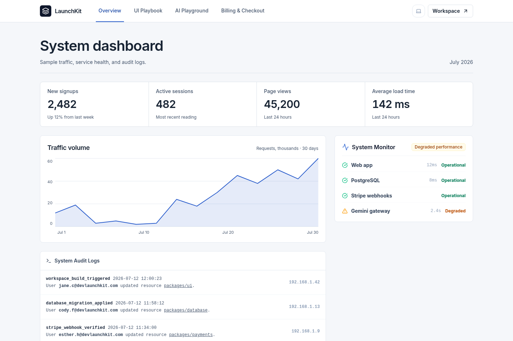
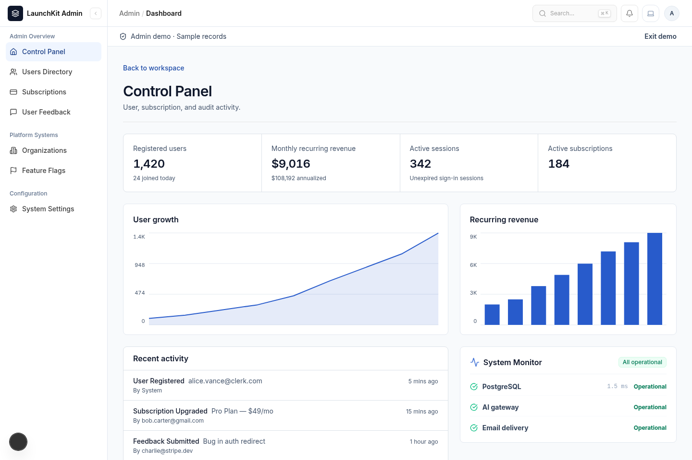

# DevLaunchKit

A Next.js SaaS starter kit with a workspace dashboard, admin console, and shared TypeScript packages.



## Quick start

Use Node.js 22 and pnpm 9.15.0.

```bash
pnpm install --frozen-lockfile
pnpm dev
```

Open [localhost:3000](http://localhost:3000) and select **Workspace**. The component demos use sample data. For PostgreSQL, email sign-in, and admin account provisioning, see the [quick start guide](docs/QUICK_START.md).

## Repository layout

- [apps/web](apps/web) contains the Next.js app, with public pages, the workspace, and the admin console.
- [packages](packages) contains shared code, PostgreSQL migrations, and the CLI with its standalone starter template.
- [tests/e2e](tests/e2e) contains browser checks for sign-in, admin access, and maintenance mode.
- [docs](docs) contains setup, deployment, and package guides.



Run `pnpm verify` for type checks, build, and lint. Run `pnpm test` for the package suites. See the [quick start guide](docs/QUICK_START.md) for browser tests.

[Contributing](CONTRIBUTING.md) · [License](LICENSE)
